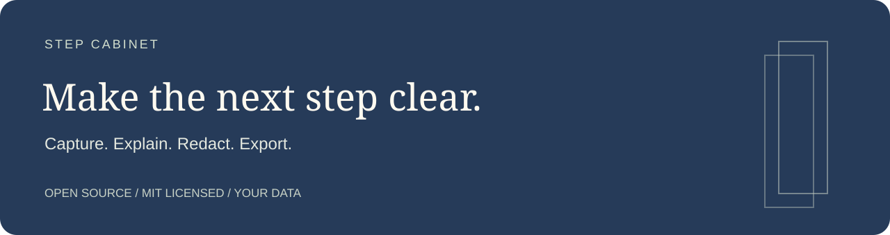
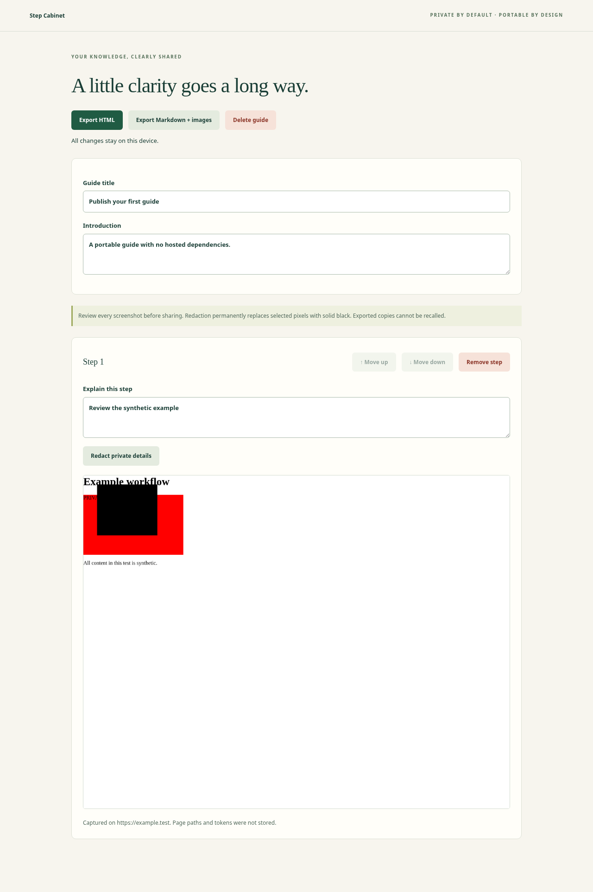

### Open-source alternative to Scribe and Guidejar for manual browser guides

Capture. Explain. Redact. Export.

**MIT licensed** · **Own your data** · **No AI service required**

[**Install locally →**](#install-locally) · [Workflow](#the-workflow) · [MIT license](LICENSE) · [Launch handoff](HANDOFF.md)

> Local candidate. Real toolbar/shortcut capture is still an owner manual acceptance gate.

*Actual extension editor using a synthetic screenshot fixture. Real toolbar capture remains unverified.*

## The workflow

**Capture a visible step → edit the explanation → redact → export HTML or Markdown.**

Capture browser steps on demand, edit the explanation, permanently redact screenshots, and export a guide that works without a hosting service.

This is the OpenSteps queue candidate. It targets the basic guide-authoring workflow of Scribe and Guidejar, with deliberate manual capture rather than automatic click tracking. No AI, account, upload endpoint or third-party runtime code.

## Install locally

1. Open `chrome://extensions` in Chromium or Chrome.
2. Enable Developer mode, choose **Load unpacked**, and select this directory (the one containing manifest.json).
3. Pin Step Cabinet. Open a regular HTTP/HTTPS page, click the extension, and create a guide.
4. Click **Capture this step** after each action you want to document. The optional `Alt+Shift+S` shortcut can be configured at `chrome://extensions/shortcuts` if it conflicts with your OS.
5. Choose **Review & export**. Edit captions, reorder/remove steps, and redact sensitive areas. Export one self-contained HTML file or a ZIP with Markdown and PNG images.

Only the visible viewport is captured; scrolling and additional pages require additional captures. Browser internal pages, extension pages and files are unsupported. Chrome may rate-limit rapid screenshots. On errors, no fake step is added. Review the saved step count before moving on.

## Privacy and permissions

- `activeTab`: capture the page only after invoking the extension or its command; no broad host permissions.
- `storage`: keep guides in this browser's local extension storage, not sync storage.
- `unlimitedStorage`: screenshots can exceed Chrome's ordinary small storage quota. The application limits guides to 30 and steps per guide to 40; images must be PNG data URLs below 12 MiB.
- No analytics, outbound application requests, content scripts, automatic page monitoring or account credentials.

Screenshots may contain secrets. Review the page before capture and redact before export. A dragged redaction rectangle overwrites pixels with solid black and replaces the stored screenshot. It cannot be undone in the app; previous exports, browser storage backups and temporary process memory are outside that guarantee. The application does not promise forensic secure erasure. Only a source origin is retained; paths, query strings and fragments are discarded and origins are omitted from exports.

Delete a step or guide to remove it from extension storage. Uninstalling removes the extension's local data; back up exports first. Exports are for viewing and downstream editing, not re-importing into this version. No team sync, automatic click tracking, hosted embeds, video or OCR. Redaction currently uses pointer dragging and has no keyboard rectangle editor.

## Validation and current limits

`node --test core.test.js worker.test.js` runs 16 unit and worker tests with no dependencies. These cover capture error handling, serialization, stale edits, deletion, escaping, portable exports and validation. Worker capture tests use mocked Chrome APIs.

The real extension loaded in Chromium and passed creation, editing, screenshot redaction, reload persistence, HTML download/open, ZIP download and deletion using an explicitly synthetic screenshot fixture. ZIP CRCs and extracted PNGs were independently verified. The browser test did **not** prove real toolbar/shortcut capture permission: synthesized shortcut input did not trigger Chromium's command handler. Manual browser-action capture remains an acceptance gate before a public release. This is a local candidate, not a published or store-approved extension.

`artifacts/editor.png` is the actual editor screenshot with synthetic test content. `artifacts/validation.json` records the evidence and remaining gates. The repository's CI runs the pure Node tests.

## Distribution package

Audience: technical educators, small support teams and agency operators writing repeatable instructions. Proposed headline: **“Capture steps. Redact private details. Keep the guide.”**

First demo: author a real, useful onboarding tutorial, redact a synthetic private field, export HTML, disconnect the network, and open the guide. Share the useful tutorial alongside the runnable extension. Before an external listing, verify its current eligibility rules and complete real capture acceptance. No directory submissions or promotional posts have been sent.

Comparison references: https://scribe.com/ and https://appsumo.com/products/guidejar/ . This is a narrow manual guide-authoring alternative, not a feature-parity claim. Verify current competitors before publishing prices or feature comparisons.

License: MIT.

## Owner launch handoff

See [HANDOFF.md](HANDOFF.md) for the exact real-toolbar acceptance procedure, synthetic test page, prefilled repository form and publication boundaries. Public source push, releases and deployment require a separate product-specific go-ahead.
